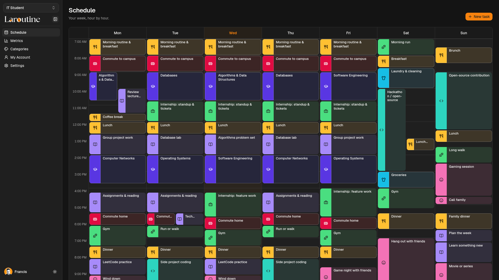

# 



Laroutine is a responsive dashboard for planning a weekly routine around a daily schedule. It is a single-user, local-first app: all data lives in one SQLite file.

## Features

- **Weekly schedule** (home page): days of the week as columns, user-defined times as rows. Times follow the selected locale (24h for pt-BR, AM/PM for en-US). Overlapping tasks are shown side by side.
- **Tasks**: name, optional description, optional GIF (by URL), category, start/end time and one or more days. Hovering a task for 300 ms shows a tooltip; clicking opens the edit popup.
- **Categories**: name, a lucide icon and an optional color, created in a dedicated area or directly from the task popup. The color is one of 8 presets or any custom color from the built-in picker (saturation/brightness area, hue slider, hex input, live preview on dark and light surfaces). Custom colors are stored as `#rrggbb`; the icon color is chosen automatically (black or white, whichever has the better contrast).
- **Workspaces**: each workspace has its own schedule and metrics, selectable at the top of the sidebar.
- **Métricas**: charts (recharts) of planned hours per category, planned hours per day and task count per category.
- **Configurações**: language (pt-BR / en), week start (Sunday / Monday), time zone (automatic or any IANA zone; only affects "now"/"today") and the schedule grid (start hour, end hour, slot interval of 15, 30 or 60 minutes).
- **Minha Conta**: local profile (display name, optional avatar URL).
- Dark theme by default, with a light/dark switch.

## Stack

Next.js (App Router, `output: "standalone"`), React, Tailwind CSS v4 with shadcn/ui, lucide-react, recharts, and SQLite through [better-sqlite3](https://github.com/WiseLibs/better-sqlite3).

## Quick start (from source)

Requirements: Node.js >= 22 (see `engines` in `package.json`) and npm. better-sqlite3 is a native module; it normally installs a prebuilt binary, otherwise it compiles from source and needs Python 3, make and a C/C++ compiler.

```bash
git clone https://github.com/FrancisBernard34/laroutine.git && cd laroutine
npm install
npm run build
npm start
```

Then open <http://localhost:3000>.

`npm start` runs the standalone server (`.next/standalone/server.js`) after copying `.next/static` and `public` next to it. (`next start` does not work with standalone output.)

Environment variables:

| Variable | Default | Description |
| --- | --- | --- |
| `LAROUTINE_DB_PATH` | `./data/laroutine.db` | Path of the SQLite file. Directory and file are created on first use. |
| `PORT` | `3000` | HTTP port. |
| `HOSTNAME` | all interfaces | Interface to bind (e.g. `127.0.0.1` for local only). |

For development use `npm run dev`. Tests: `npm test`.

### better-sqlite3 install scripts

better-sqlite3 13 ships prebuilt binaries, so a plain `npm install` normally works. `package.json` also contains an `allowScripts` entry so that npm versions that gate install scripts still run better-sqlite3's. If the module fails to load (e.g. "Could not locate the bindings file"), run:

```bash
npm rebuild better-sqlite3
```

## Docker

Build and run, with a single volume for the database:

```bash
docker build -t laroutine .
docker run -d --name laroutine -p 3000:3000 -v laroutine-data:/data laroutine
```

Or with Docker Compose:

```bash
docker compose up -d --build
```

The container listens on port 3000, runs as the non-root `node` user and stores the database at `/data/laroutine.db` (`LAROUTINE_DB_PATH`). If you bind-mount a host directory instead of a named volume, make sure it is writable by UID 1000.

## Data and backups

Everything is stored in the one SQLite file (`./data/laroutine.db` from source, `/data/laroutine.db` in Docker). The database uses SQLite's default rollback journal mode (no WAL), so it is a single file. To back up, stop the app first and then copy that file (or copy it from the stopped container's volume, e.g. `docker cp laroutine:/data/laroutine.db .`). To restore, with the app stopped, put the file back in place.

## Design notes

Custom category colors are rendered exactly as chosen in both themes (presets are theme-tuned). Very light or very dark custom colors get a subtle outline on tiles, swatches and chart slices so they stay visible; the stored value is never changed. The database upgrades itself on start (migration 3 rebuilds `categories`; existing data is kept).
## Contributing / Architecture

Issues and pull requests are welcome at <https://github.com/FrancisBernard34/laroutine/issues>. Before opening a pull request, run `npm test`, `npx tsc --noEmit`, `npm run lint` and `npm run build`. For how the code is organized (data model and migrations, server actions, i18n, time handling, the schedule layout algorithm, theming and Docker notes), read [docs/architecture.md](docs/architecture.md).

## Security note

Laroutine has **no authentication**. It is meant for a single user on a trusted machine or network. Do not expose it to the public internet without a reverse proxy that provides authentication (and HTTPS).

## License

[MIT](LICENSE) © 2026 Laroutine contributors. Free to use, modify, redistribute and use commercially, provided as is with no warranty or liability.
